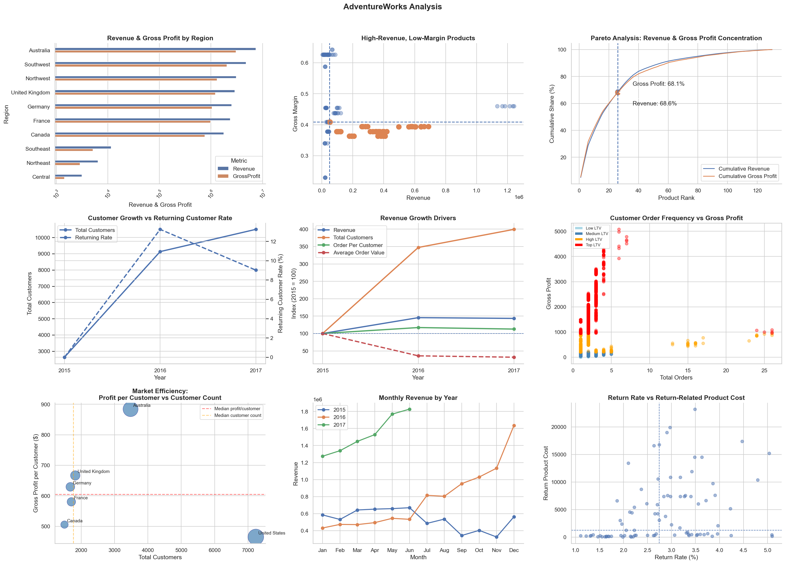

# AdventureWorks Business Performance Analysis

An end-to-end business data analysis project using SQL and Python to investigate product profitability, customer behavior, regional performance, revenue growth, and product returns.

## 1. Project Overview

### Business Context

Businesses need to understand not only how much revenue they generate, but also which products and markets contribute the most profit, how customers behave over time, and where operational improvements may create value.

This project analyzes the AdventureWorks sample dataset to investigate business performance across products, regions, customers, and sales periods.

The objective is to turn transactional data into actionable business insights that can support better decisions about product profitability, customer retention, market performance, and return reduction.

### Key Objectives

- Evaluate revenue, gross profit, and gross margin across regions and products.
- Identify high-revenue products with relatively low gross margins.
- Measure product revenue and gross profit concentration.
- Examine returning-customer behavior and revenue growth patterns.
- Compare market profitability relative to customer count.
- Investigate monthly revenue patterns and return-related product costs.

## 2. Business Questions

| # | Business Question |
|---|---|
| Q1 | Which regions generate the most revenue and gross profit? |
| Q2 | Which products generate high revenue but relatively low gross margins? |
| Q3 | What share of revenue and gross profit comes from the top 20% of products? |
| Q4 | What proportion of annual customers return in subsequent years? |
| Q5 | How do customer count, purchase frequency, and average order value change alongside revenue? |
| Q6 | How does customer order frequency relate to cumulative gross profit? |
| Q7 | Which markets generate the highest gross profit per customer, and how does that compare with market size? |
| Q8 | What monthly revenue patterns and potential seasonal trends can be observed? |
| Q9 | Which products have the highest return-related product costs, and where should return-reduction efforts focus? |

## 3. Key Business Findings

*The findings below should be finalized using the verified outputs from the completed analysis.*

### 1. Product Concentration

The top 20% of products account for approximately two-thirds of revenue and gross profit, if confirmed by the final calculations.

**Business implication:** A relatively small group of products may account for a substantial share of business performance. Management should monitor these products closely and assess the risks associated with relying on a concentrated product portfolio.

### 2. High-Revenue, Low-Margin Products

Several products generate above-median revenue while having below-median gross margins.

**Business implication:** High sales alone do not necessarily indicate strong profitability. These products warrant further investigation into pricing, product costs, and opportunities to improve gross profit.

### 3. Regional Profitability Differences

Regional revenue and gross profit contributions differ, and regions may vary in their ability to convert revenue into gross profit.

**Business implication:** Regional performance should be evaluated using both absolute contribution and gross margin rather than revenue alone.

### 4. Customer Retention and Revenue Growth

The analysis examines returning customers across years and tracks changes in customer count, orders per customer, and average order value.

**Business implication:** Understanding whether growth accompanies an expanding customer base, increased purchase frequency, or higher order value can help identify opportunities for more sustainable growth.

### 5. Differences in Market Economics

Gross profit per customer varies across countries, while total gross profit and customer counts reveal differences in market scale.

**Business implication:** Markets with high gross profit per customer may warrant further investigation for growth opportunities. Investment decisions should also consider total contribution, market potential, and operating costs.

### 6. Monthly Revenue Patterns

The monthly revenue analysis shows how sales change throughout the observed period. A recurring November-to-December increase in the two complete years should be verified in the final output before being reported as a finding.

**Business implication:** Historical monthly patterns can inform inventory and capacity planning, although additional years are needed to establish a reliable seasonal pattern.

### 7. Return-Related Product Costs

The analysis compares product return rates with the product cost associated with returned units.

**Business implication:** Products with both high return rates and high return-related costs can be prioritized for further investigation. Additional information is needed to establish the causes of returns and estimate recoverable savings.

## 4. Strategic Recommendations

Based on the verified results, the following actions can be investigated:

1. **Monitor concentrated product performance.** Track revenue and gross profit contributions from leading products and assess the potential impact of supply or demand disruptions.
2. **Investigate low-margin, high-revenue products.** Review product pricing, costs, and commercial positioning before making changes.
3. **Evaluate regional performance using multiple KPIs.** Consider gross profit, gross margin, and revenue together when reviewing market opportunities.
4. **Investigate customer retention.** Compare cross-year purchasing behavior and identify customer segments that may benefit from targeted retention initiatives.
5. **Prioritize return investigations.** Examine products with high return rates and high return-related product costs to determine whether product information, quality, or other factors contribute to returns.
6. **Use monthly sales patterns for planning.** Review historical demand patterns when planning inventory and operational capacity, while accounting for the limited observation period.

These recommendations identify areas for further investigation; the analysis does not independently establish causal relationships or guarantee financial improvements.

## 5. Methodology

### Data Preparation

- Loaded and inspected the source CSV files using pandas.
- Combined sales records from 2015, 2016, and 2017.
- Reviewed dataset dimensions, missing values, duplicates, and key relationships.
- Loaded the datasets into an in-memory SQLite database for SQL-based analysis.

### KPI Definitions

| KPI | Definition |
|---|---|
| Revenue | Order Quantity × Product Price |
| Product Cost | Order Quantity × Product Cost |
| Gross Profit | Order Quantity × (Product Price − Product Cost) |
| Gross Margin | Gross Profit ÷ Revenue |
| Average Order Value | Revenue ÷ Number of Orders |
| Orders per Customer | Number of Orders ÷ Number of Customers |
| Gross Profit per Customer | Total Gross Profit ÷ Distinct Customers |
| Return-Related Product Cost | Returned Quantity × Product Cost |
| Return Rate | Returned Quantity ÷ Sold Quantity × 100 |

Gross profit is calculated using the supplied product prices and costs. It does not account for other operating expenses, marketing costs, shipping, or overhead.

### Analytical Techniques

- SQL aggregation and joins
- Product ranking and cumulative concentration analysis
- Median-based product segmentation
- Year-over-year KPI comparisons
- Customer-level aggregation
- Regional and country-level profitability analysis
- Monthly time-series visualization
- Return-rate and return-cost comparisons

## 6. Tools and Technologies

- **Python:** analysis and data preparation
- **pandas:** data manipulation and KPI calculations
- **SQL / SQLite:** data aggregation, joins, and business queries
- **Matplotlib:** chart construction
- **Seaborn:** statistical visualization
- **Jupyter Notebook:** analysis workflow and documentation

## 7. Limitations

- The available 2017 data covers only part of the year; comparisons with complete years must use equivalent periods or clearly disclose the limitation.
- Only two complete years are available for evaluating recurring seasonal patterns.
- Gross profit does not represent net profit or total business profitability.
- Median-based thresholds are relative benchmarks, not universal definitions of good or poor performance.
- Historical gross profit per customer is not predictive customer lifetime value.
- Return-related product cost is not necessarily an actual financial loss or recoverable amount.
- The analysis identifies associations and patterns but does not establish causation.

## 8. Dataset

**Source:** AdventureWorks sample dataset.

[Kaggle — AdventureWorks Dataset](https://www.kaggle.com/datasets/ukveteran/adventure-works)

Download the required CSV files and place them in the local `data/` directory. Check the source's terms before redistributing the dataset.

## 9. How to Run

1. Clone or download this repository.
2. Install Python and the required packages.
3. Download the dataset and place the required CSV files in the `data/` directory.
4. Open `adventureworks_analysis.ipynb` in Jupyter Notebook or JupyterLab.
5. Run the notebook from top to bottom.

## 10. Project Outcome

This project demonstrates an end-to-end analytical workflow: translating business questions into KPIs, querying and transforming data, comparing business performance across multiple dimensions, visualizing findings, and developing evidence-based recommendations.